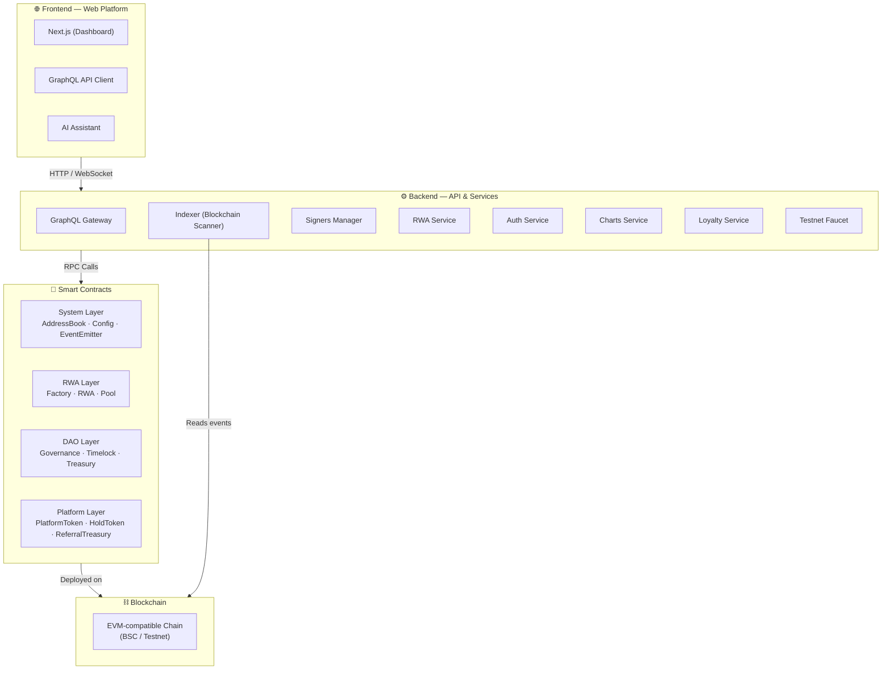

# Architecture

The Slices platform consists of three layers that work together to enable real-world asset tokenization and crowdfunding.

## System Overview

## Smart Contracts

The on-chain layer consists of upgradeable Solidity contracts deployed on EVM-compatible blockchains:

- **System layer** — AddressBook (registry), Config (parameters), EventEmitter (logging)
- **RWA layer** — Factory (deployment), RWA (ERC1155 tokens), Pool (crowdfunding + AMM)
- **DAO layer** — Governance, Timelock, Treasury, DaoStaking
- **Platform layer** — PlatformToken, ReferralTreasury, HoldToken

All contracts use the UUPS upgradeable proxy pattern, allowing logic updates without changing contract addresses.

## Backend Services

The backend consists of multiple independent services, each running as a separate Elysia process. A **GraphQL Gateway** service acts as the primary API facade, routing requests to the appropriate backend service:

- **GraphQL API** — the primary interface for the web platform and external integrations, powered by a gateway that proxies to specialized services
- **RWA Service** — manages businesses, pools, token metadata, and coordinates multi-signature approvals
- **AI Assistant** — [conversational AI](/docs/ai-assistant/overview) for user support and portfolio insights
- **Signers Manager** — [coordinates multi-signature approvals](/docs/signers-manager/overview) for contract deployments
- **Indexer (Blockchain Scanner)** — listens to on-chain events and maintains a queryable database
- **Charts** — [price data, OHLC, volume](/docs/charts/overview), and WebSocket updates
- **Loyalty** — [referral rewards](/docs/loyalty/overview) for bringing new users to the platform
- **Testnet Faucet** — [free test tokens](/docs/testnet-faucet/overview) on BSC Testnet
- **Auth** — wallet-based authentication and token management
- **Company** — company profiles and member management
- **DAO** — governance data indexing (proposals, votes, staking, treasury)
- **Documents, Gallery, FAQ, Blog, Portfolio, Questions, Reactions, Files** — supporting services for platform features

## Data Layer

On-chain data (events, state) is indexed by the backend and stored in a database for fast querying. The GraphQL API provides access to:

- **Business profiles** — company information, risk scores, social links
- **Pool data** — configuration, state, reserves, tranches
- **Portfolio data** — token balances, transaction history
- **Governance data** — proposals, votes, staking positions, timelock tasks
- **Chart data** — price history, volume, OHLC data

## Key Flows

**Business onboarding:**
1. Create a company profile via the web platform
2. Request multi-signature approval for RWA deployment
3. Deploy RWA token contract via Factory
4. Configure and deploy a Pool

**Pool participation:**
1. Browse available pools on the platform
2. Contribute HOLD tokens via Pool.mint()
3. Track pool performance via charts and portfolio
4. Exit the pool via Pool.burn() when returns are available

**Governance:**
1. Stake PlatformTokens in DaoStaking
2. Create or vote on proposals
3. Monitor proposal execution through the timelock
