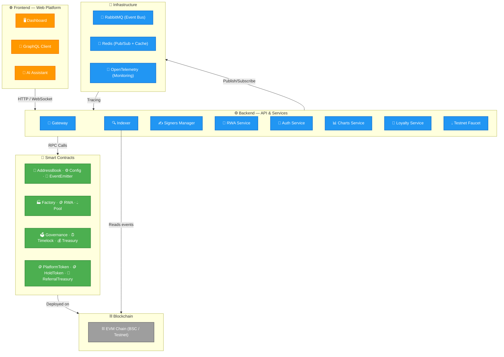

# Architecture

The Slices platform consists of three layers that work together to enable real-world asset tokenization and crowdfunding.

## System Overview

## Smart Contracts

The on-chain layer consists of upgradeable Solidity contracts deployed on EVM-compatible blockchains:

- **System layer** — AddressBook (registry), Config (parameters), EventEmitter (logging)
- **RWA layer** — Factory (deployment), RWA (ERC1155 tokens), Pool (crowdfunding + AMM)
- **DAO layer** — Governance, Timelock, Treasury, DaoStaking
- **Platform layer** — PlatformToken, ReferralTreasury, HoldToken

All contracts use the UUPS upgradeable proxy pattern, allowing logic updates without changing contract addresses.

## Backend Services

The backend consists of **20 independent microservices**, each running as a separate Elysia process. A **GraphQL Gateway** (Yoga GraphQL Server) acts as the primary API facade, routing requests to the appropriate backend service:

- **GraphQL Gateway** — the primary interface for the web platform and external integrations, powered by Yoga GraphQL Server that proxies to specialized services
- **RWA Service** — manages businesses, pools, token metadata, and coordinates multi-signature approvals; uses Redis, RabbitMQ, and OpenRouter
- **AI Assistant** — [conversational AI](/docs/ai-assistant/overview) for user support and portfolio insights; uses OpenRouter API
- **Signers Manager** — [coordinates multi-signature approvals](/docs/signers-manager/overview) for contract deployments
- **Signer** — executes transaction signing; receives signing requests via RabbitMQ, uses a private key
- **Blockchain Scanner (Indexer)** — listens to on-chain events via RPC and publishes them to RabbitMQ; runs as a daemon
- **Charts** — [price data, OHLC, volume](/docs/charts/overview), and WebSocket updates; uses Redis pub/sub and RabbitMQ
- **Loyalty** — [referral rewards](/docs/loyalty/overview) for bringing new users to the platform; uses RabbitMQ
- **Testnet Faucet** — [free test tokens](/docs/testnet-faucet/overview) on BSC Testnet
- **Auth** — wallet-based authentication and JWT token management
- **Company** — company profiles and member management
- **DAO** — governance data indexing (proposals, votes, staking, treasury, timelock); uses RabbitMQ
- **Documents, Gallery, FAQ, Blog, Portfolio, Questions, Reactions, Files** — supporting services for platform features (CRUD operations)

All services are built with **Elysia** (Bun framework) and follow a plugin-based architecture: repositories (MongoDB), clients (RabbitMQ/Redis), services (business logic), controllers (routes), and daemons (background tasks).

## Infrastructure

The platform relies on the following infrastructure components, orchestrated via **Docker Compose**:

- **RabbitMQ** — acts as the central event bus for inter-service communication. Services publish domain events (e.g., `pool.created`, `signature.requested`) and consume relevant events from other services.
- **Redis** — used for:
  - **Pub/Sub** — real-time updates for charts and WebSocket connections
  - **Caching** — frequently accessed data (e.g., token metadata, user sessions)
- **OpenTelemetry** — distributed tracing across all services. Each service exports traces to a collector (e.g., Jaeger or Grafana Tempo) for monitoring and debugging.
- **MongoDB** — each service (except Gateway and Signer) has its own MongoDB database, ensuring data isolation. The Gateway does not store data; the Signer uses only RabbitMQ for task queues.
- **Docker Compose** — defines and runs the entire stack: all 20 microservices plus RabbitMQ, Redis, MongoDB instances, and the OpenTelemetry collector.

## Data Layer

On-chain data (events, state) is indexed by the Blockchain Scanner and stored in MongoDB. The GraphQL API provides access to:

- **Business profiles** — company information, risk scores, social links
- **Pool data** — configuration, state, reserves, tranches
- **Portfolio data** — token balances, transaction history
- **Governance data** — proposals, votes, staking positions, timelock tasks
- **Chart data** — price history, volume, OHLC data

## Key Flows

**Business onboarding:**
1. Create a company profile via the web platform
2. Request multi-signature approval for RWA deployment
3. Deploy RWA token contract via Factory
4. Configure and deploy a Pool

**Pool participation:**
1. Browse available pools on the platform
2. Contribute HOLD tokens via Pool.mint()
3. Track pool performance via charts and portfolio
4. Exit the pool via Pool.burn() when returns are available

**Governance:**
1. Stake PlatformTokens in DaoStaking
2. Create or vote on proposals
3. Monitor proposal execution through the timelock
