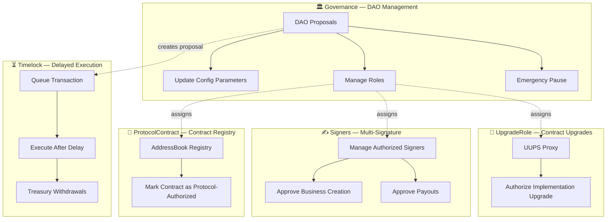

# Roles & Permissions

The Slices protocol uses a role-based access control (RBAC) system managed by the `AddressBook` contract. Each role grants specific permissions for protocol operations, ensuring that sensitive actions require appropriate authorization.

## Role Overview

| Role | Contract | Description |
|------|----------|-------------|
| **Governance** | `Governance` | Executes DAO-approved proposals — parameter changes, upgrades, treasury management |
| **Timelock** | `Timelock` | Delays and executes treasury withdrawals with a 2-day timelock delay |
| **UpgradeRole** | UUPS Proxy | Authorizes contract implementation upgrades via the UUPS pattern |
| **Signers** | `AddressBook` | Manages the set of authorized signers for multi-sig operations |
| **ProtocolContract** | `AddressBook` | Marks trusted contracts (RWA, Pool, Config, DaoStaking, Timelock, Treasury, PlatformToken, ReferralTreasury, Factory) as protocol-authorized for cross-contract calls |



## Governance

The `Governance` role is the core of the Slices DAO. It is assigned to the `Governance` contract, which executes actions approved by PlatformToken stakers through proposals.

```solidity
function requireGovernance(address account) external view {
    require(isGovernance[account], "AddressBook: not governance");
}
```

**Permissions:**
- Update protocol parameters in `Config` (fee ranges, period durations, thresholds)
- Upgrade contract implementations via UUPS
- Queue and cancel Timelock transactions (`Timelock.queueTransaction`, `Timelock.cancelTransaction`)
- Lock user stakes (`DaoStaking.lock`)
- Add or remove authorized signers
- Mint PlatformTokens (`PlatformToken.mint`)
- Pause or unpause contracts in emergencies

### Governance Contract Functions

| Function | Signature | Access |
|----------|-----------|--------|
| `propose` | `propose(address target, bytes memory data, string memory description) external returns (uint256 proposalId)` | User with ≥ `proposalThreshold` staked |
| `vote` | `vote(uint256 proposalId, bool support, string memory reason) external nonReentrant` | Any staker |
| `cancel` | `cancel(uint256 proposalId) external` | Proposer (within 12 hours) or Governance contract itself |
| `getProposal` | `getProposal(uint256 proposalId) external view returns (Proposal memory)` | Anyone |
| `getReceipt` | `getReceipt(uint256 proposalId, address voter) external view returns (Receipt memory)` | Anyone |
| `proposalCount` | `uint256 public proposalCount` (public variable) | Anyone |

> **Note:** There is no `executeProposal` function. After each vote, `_checkAutoAction()` is called internally — if quorum and majority conditions are met, the proposal is executed automatically. If the conditions are not met, it is auto-cancelled.

### Proposal Structure

```solidity
struct Proposal {
    address proposer;
    address target;
    bytes data;
    string description;
    uint256 votesFor;
    uint256 votesAgainst;
    uint256 creationTime;
    uint256 endTime;
    bool executed;
    bool cancelled;
}
```

### Receipt Structure

```solidity
struct Receipt {
    bool hasVoted;
    bool support;
    uint256 votes;
}
```

This is a mapping: `mapping(uint256 => mapping(address => Receipt)) public receipts`.

### Governance Events

| Event | Parameters |
|-------|------------|
| `ProposalCreated` | `uint256 proposalId, address proposer, address target, bytes data, string description, uint256 creationTime, uint256 endTime, bool executed, bool cancelled` |
| `VoteCast` | `uint256 proposalId, address voter, bool support, uint256 votes, string reason` |
| `ProposalCanceled` | `uint256 proposalId, address canceller` |
| `ProposalExecuted` | `uint256 proposalId, address executor` |

## Timelock

The `Timelock` role is assigned to the `Timelock` contract, which acts as a safety mechanism for treasury operations. All treasury withdrawals must go through the timelock with a **2-day delay** (`timelockDelay`).

```solidity
function requireTimelock(address account) external view {
    require(isTimelock[account], "AddressBook: not timelock");
}
```

**Permissions:**
- Execute treasury withdrawals after the timelock delay expires (`Treasury.withdrawERC20`, `Treasury.withdrawETH`)

### Timelock Contract Functions

| Function | Signature | Access |
|----------|-----------|--------|
| `queueTransaction` | `queueTransaction(address target, bytes memory data, uint256 eta) external` | Governance (`requireGovernance`) |
| `cancelTransaction` | `cancelTransaction(address target, bytes memory data, uint256 eta) external` | Governance (`requireGovernance`) |
| `executeTransaction` | `executeTransaction(address target, bytes memory data, uint256 eta) external` | **Anyone** (no access control) |
| `isTransactionQueued` | `isTransactionQueued(address target, bytes memory data, uint256 eta) external view returns (bool)` | Anyone |
| `isTransactionReady` | `isTransactionReady(address target, bytes memory data, uint256 eta) external view returns (bool)` | Anyone |
| `getTransactionETA` | `getTransactionETA(address target, bytes memory data, uint256 eta) external view returns (uint256)` | Anyone |

> **Note:** `executeTransaction` has **no access control** — once a transaction is queued and the ETA has passed, anyone can execute it. The transaction must be executed before `eta + GRACE_PERIOD` (7 days), otherwise it becomes invalid.

### Timelock Events

| Event | Parameters |
|-------|------------|
| `Timelock_TransactionQueued` | `bytes32 indexed txHash, address target, bytes data, uint256 eta` |
| `Timelock_TransactionExecuted` | `bytes32 indexed txHash, address target, bytes data, uint256 eta` |
| `Timelock_TransactionCancelled` | `bytes32 indexed txHash, address target, bytes data, uint256 eta` |

## UpgradeRole

The `UpgradeRole` controls contract implementation upgrades via the UUPS (Universal Upgradeable Proxy Standard) pattern. Only authorized accounts can upgrade a proxy to a new implementation.

```solidity
function _authorizeUpgrade(address newImplementation) internal override {
    addressBook.requireUpgradeRole(msg.sender);
}
```

**Permissions:**
- Upgrade any UUPS proxy contract to a new implementation address
- This role is typically held by the `Governance` contract after a successful proposal

## Signers

The `Signers` role manages a set of authorized addresses that can perform multi-sig operations. Signers are added or removed by the `Governance` role through proposals.

```solidity
function addSigner(address signer) external {
    addressBook.requireGovernance(msg.sender);
    // Adds signer to the authorized set
}

function removeSigner(address signer) external {
    addressBook.requireGovernance(msg.sender);
    // Removes signer from the authorized set
}
```

**Permissions:**
- Participate in multi-sig approvals for critical operations
- Sign transactions that require multiple confirmations

## ProtocolContract

The `ProtocolContract` role marks contracts as trusted within the protocol ecosystem. This allows authorized contracts to call restricted functions on other protocol contracts. The set of protocol contracts includes: **RWA**, **Pool**, **Config**, **DaoStaking**, **Timelock**, **Treasury**, **PlatformToken**, **ReferralTreasury**, and **Factory**.

```solidity
function requireProtocolContract(address account) external view {
    require(isProtocolContract[account], "AddressBook: not protocol contract");
}
```

**Permissions:**
- Call restricted cross-contract functions
- Interact with other protocol contracts at the system level

**Assignment:**
- Governance sets the implementation addresses via `setRWAImplementation` and `setPoolImplementation`
- Factory adds newly created RWA and Pool contracts to the protocol contract registry via `addRWA` and `addPool`
- Other system contracts (Config, DaoStaking, Timelock, etc.) are registered as protocol contracts when their addresses are set through their respective setter functions

## Permission Matrix

| Action | Governance | Timelock | UpgradeRole | Signers | ProtocolContract |
|--------|:----------:|:--------:|:-----------:|:-------:|:----------------:|
| Update Config parameters | ✅ | ❌ | ❌ | ❌ | ❌ |
| Upgrade contract implementation | ✅ | ❌ | ✅ | ❌ | ❌ |
| Queue/cancel Timelock transactions | ✅ | ❌ | ❌ | ❌ | ❌ |
| Execute Timelock transaction (after ETA) | ❌ | ❌ | ❌ | ❌ | ❌ (anyone) |
| Treasury withdrawal (ERC20/ETH) | ❌ | ✅ | ❌ | ❌ | ❌ |
| Lock user stakes | ✅ | ❌ | ❌ | ❌ | ❌ |
| Add/remove signers | ✅ | ❌ | ❌ | ❌ | ❌ |
| Mint PlatformTokens | ✅ | ❌ | ❌ | ❌ | ❌ |
| Pause/unpause contracts | ✅ | ❌ | ❌ | ❌ | ❌ |
| Cross-contract system calls | ❌ | ❌ | ❌ | ❌ | ✅ |
| Multi-sig signing | ❌ | ❌ | ❌ | ✅ | ❌ |

## Role Assignment

Roles are managed through the `AddressBook` contract. The `Governance` role is the root of authority — it can reassign other roles through DAO proposals.

| Role | Assigned By | Current Holder |
|------|-------------|----------------|
| **Governance** | Initial deployment | `Governance` contract |
| **Timelock** | Governance proposal | `Timelock` contract |
| **UpgradeRole** | Governance proposal | `Governance` contract |
| **Signers** | Governance proposal | Set of authorized addresses |
| **ProtocolContract** | Governance proposal | Set of protocol contracts |

> **Note:** All role assignments are controlled by the DAO. No single entity has unilateral control over any role — changes require a successful governance proposal.
