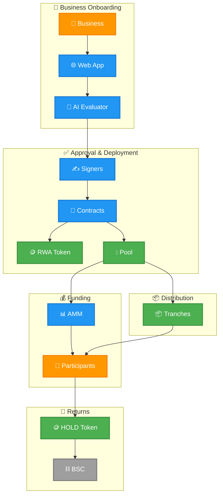

# Slices Documentation

Slices democratizes access to real-world asset investments by enabling anyone to participate in tokenized crowdfunding pools. Key concepts: **RWA** (Real-World Asset) — tokenized representation of physical assets; **BSC** — Binance Smart Chain, the underlying blockchain; **HOLD** — platform's native utility token; **AMM** — Automated Market Maker for price discovery; **tranches** — automated distribution tiers; **DAO** — Decentralized Autonomous Organization for governance.

## Get Started

New to Slices? Start here:

- **[Quick Start](/docs/get-started/quickstart)** — Launch your first RWA pool end-to-end (Quick start guide)
- **[Core Concepts](/docs/get-started/concepts)** — The building blocks of the platform (Core concepts)
- **[Architecture](/docs/get-started/architecture)** — How the system fits together (System architecture)
- **[Resources](/docs/resources/overview)** — Additional guides and references

## Explore by Domain

- **[Tokenization](/docs/tokenization/overview)** — Turn real-world assets into on-chain instruments (Tokenize real-world assets)
- **[Pools](/docs/pools/overview)** — Crowdfunding pools with AMM pricing (Crowdfunding pools)
- **[Trading](/docs/trading/overview)** — Secondary market for RWA tokens (Secondary market)
- **[Governance](/docs/governance/overview)** — PlatformToken staking, proposals, voting (DAO governance)

## Build & Integrate

- **[Smart Contracts](/docs/smart-contracts/overview)** — Contract architecture, access control, upgradeability (Contract architecture)
- **[Contract Reference](/docs/smart-contracts/overview)** — All functions, events, and access control (Full function reference)
- **[Deployments](/docs/smart-contracts/overview)** — Contract addresses on BSC Testnet (Contract addresses)
- **[Fees](/docs/fees/overview)** — Creation fees, trading fees, and protocol parameters (Fee structure)
- **[API Reference](/docs/api/overview)** — Complete GraphQL API documentation (GraphQL API)
- **[AI Agents](/docs/ai-agents/overview)** — Documentation for AI agents interacting with the platform (AI agent docs)

## Platform Services

- **[AI Risk Evaluator](/docs/ai-evaluator/overview)** — Automated risk scoring for businesses and pools (Risk scoring)
- **[AI Assistant](/docs/ai-assistant/overview)** — Conversational AI for investment guidance (Conversational AI)
- **[Signers Manager](/docs/signers-manager/overview)** — Multi-signature approval coordination (Multi-sig)
- **[Charts & Real-Time Data](/docs/charts/overview)** — Price data, OHLC, volume, WebSocket updates (Price data)
- **[Referral & Loyalty](/docs/loyalty/overview)** — Referral rewards, treasury withdrawals, and airdrop data (Referral program)
- **[Testnet Faucet](/docs/testnet-faucet/overview)** — Get test tokens on BSC Testnet (Test tokens)

## Integration

- **[API Keys](/docs/api-keys/overview)** — Persistent authentication keys for programmatic access (API authentication)
- **[Webhooks](/docs/webhooks/overview)** — Receive real-time event notifications via HTTP (Event notifications)

## How It Works

1. **Business Onboarding** — A business registers on the platform and undergoes AI-powered risk evaluation.
2. **Approval & Deployment** — Authorized signers review and approve the RWA token and pool deployment.
3. **Funding** — Participants contribute HOLD tokens to the pool and receive RWA tokens via the AMM.
4. **Distribution** — When the funding target is reached, tranches automatically distribute funds to the business.
5. **Returns** — The business repays funds through incoming tranches; participants burn RWA tokens to claim returns.

