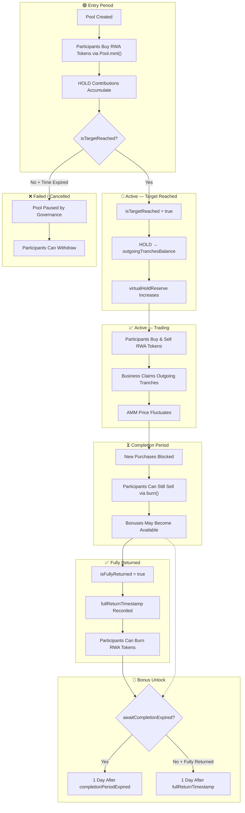

---
title: Pool Lifecycledescription: From creation to maturity — every stage of a pool
---cle

A pool progresses through several stages from creation to completion.

## Stage 1: Entry Period

The entry period begins at `entryPeriodStart` and ends at `entryPeriodExpired`.

During this stage:

- **Participants can buy RWA tokens** via `Pool.mint()`
- **The business cannot claim outgoing tranches** (target not yet reached)
- **The pool accumulates HOLD contributions**

The entry period ends early if the pool reaches its funding target (`isTargetReached = true`).

## Stage 2: Active (Target Reached)

When `awaitingRwaAmount >= expectedRwaAmount`, the target is reached:

1. `isTargetReached` is set to `true`
2. The expected HOLD amount is moved to `outgoingTranchesBalance`
3. `virtualHoldReserve` increases by `expectedHoldAmount`
4. `realHoldReserve` decreases by `expectedHoldAmount`
5. Floating timestamp offset is calculated if applicable
6. A `Pool_TargetReached` event is emitted

The business owner can now claim outgoing tranches according to their schedule.

## Stage 3: Active (Trading)

After the target is reached and until `completionPeriodExpired`:

- **Participants can buy and sell RWA tokens** via `mint()` and `burn()`
- **The business can claim outgoing tranches**
- **The business can return funds** via `returnIncomingTranche()`
- **The AMM price fluctuates** based on trading activity

## Stage 4: Completion Period

After `completionPeriodExpired`:

- **Participants can still sell RWA tokens** via `burn()`
- **New purchases are blocked** (completion period expired)
- **Bonuses may become available** depending on the `awaitCompletionExpired` flag
- **The business can still return funds**

## Stage 5: Fully Returned

When `totalReturnedAmount >= expectedHoldAmount + expectedBonusAmount`:

1. `isFullyReturned` is set to `true`
2. `fullReturnTimestamp` is recorded
3. A `Pool_FundsFullyReturned` event is emitted
4. Participants can burn their RWA tokens to claim their share

## Bonus Unlock

Bonuses unlock based on the `awaitCompletionExpired` flag:

- **If `awaitCompletionExpired = true`** — bonuses unlock 1 day after `completionPeriodExpired`
- **If `awaitCompletionExpired = false` and funds are fully returned** — bonuses unlock 1 day after `fullReturnTimestamp`
- **If `awaitCompletionExpired = false` but funds are NOT fully returned** — bonuses unlock 1 day after `completionPeriodExpired` (fallback)

## Failed / Cancelled

A pool can be paused by Governance in emergencies via `enablePause()`. When paused, all mint, burn, and claim operations are blocked until `disablePause()` is called.
