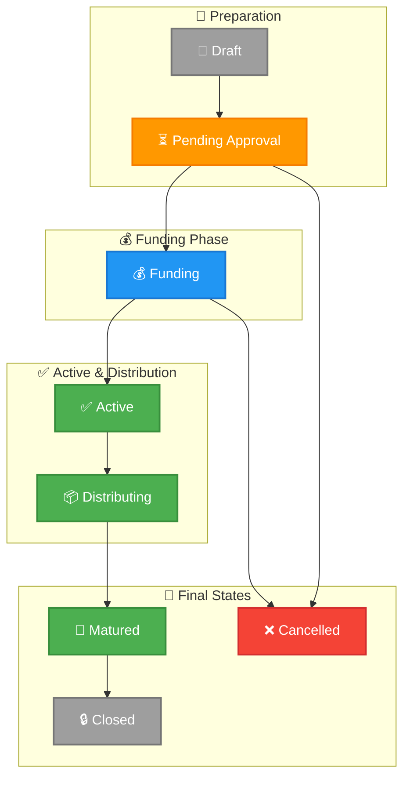

# Pool Lifecycle

A pool progresses through several stages from creation to completion.

## Static Configuration Parameters

These parameters are set during pool initialization and remain immutable throughout the pool's lifecycle:

- **`fixedSell`** (`bool`) — If `true`, the total amount of RWA tokens that can be minted is capped at `expectedRwaAmount`. Once the fixed amount is fully sold, no more RWA can be minted via `Pool.mint()`. If `false`, minting continues based on AMM reserves without a hard cap.
- **`allowEntryBurn`** (`bool`) — If `true`, participants can burn RWA tokens (sell) via `Pool.burn()` during the entry period. If `false`, burning is blocked until the entry period expires, preventing early exits before the target is reached.

## Stage 1: Entry Period

The entry period begins at `entryPeriodStart` and ends at `entryPeriodExpired`.

During this stage:

- **Participants can buy RWA tokens** via `Pool.mint()`
- **The business cannot claim outgoing tranches** (target not yet reached)
- **The pool accumulates HOLD contributions**

The entry period ends early if the pool reaches its funding target (`isTargetReached = true`).

## Stage 2: Active (Target Reached)

When `awaitingRwaAmount >= expectedRwaAmount`, the target is reached:

1. `isTargetReached` is set to `true` — this flag indicates that the pool has met its funding target and outgoing tranches become claimable
2. The expected HOLD amount is moved to `outgoingTranchesBalance`
3. `virtualHoldReserve` increases by `expectedHoldAmount`
4. `realHoldReserve` decreases by `expectedHoldAmount`
5. Floating timestamp offset is calculated if `floatingOutTranchesTimestamps` is enabled
6. A `Pool_TargetReached` event is emitted

The business owner can now claim outgoing tranches according to their schedule.

## Stage 3: Active (Trading)

After the target is reached and until `completionPeriodExpired`:

- **Participants can buy and sell RWA tokens** via `mint()` and `burn()`
- **The business can claim outgoing tranches**
- **The business can return funds** via `returnIncomingTranche()`
- **The AMM price fluctuates** based on trading activity

### Outgoing Tranches and Floating Timestamps

The pool supports configurable outgoing tranche schedules for distributing funds to the business.

- **`floatingOutTranchesTimestamps`** (`bool`) — If `true`, outgoing tranche timestamps are adjusted when the target is reached early. The offset is calculated as `(entryPeriodExpired - block.timestamp) - 1 day`, reducing all tranche timestamps by this amount. This allows the business to access funds sooner when the pool fills up quickly. If `false`, tranche timestamps remain fixed regardless of when the target is reached.

## Stage 4: Completion Period

After `completionPeriodExpired`:

- **Participants can still sell RWA tokens** via `burn()`
- **New purchases are blocked** (completion period expired)
- **Bonuses may become available** depending on the `awaitCompletionExpired` flag
- **The business can still return funds**

## Stage 5: Fully Returned

When `totalReturnedAmount >= expectedHoldAmount + expectedBonusAmount`:

1. `isFullyReturned` is set to `true` — this flag indicates that all funds (principal + bonus) have been returned by the business
2. `fullReturnTimestamp` is recorded
3. A `Pool_FundsFullyReturned` event is emitted
4. Participants can burn their RWA tokens to claim their share

## Bonus Unlock

Bonuses unlock based on the `awaitCompletionExpired` flag:

- **If `awaitCompletionExpired = true`** — bonuses unlock 1 day after `completionPeriodExpired`
- **If `awaitCompletionExpired = false` and funds are fully returned** — bonuses unlock 1 day after `fullReturnTimestamp`
- **If `awaitCompletionExpired = false` but funds are NOT fully returned** — bonuses unlock 1 day after `completionPeriodExpired` (fallback)

### Bonus Amounts

- **`awaitingBonusAmount`** (`uint256`) — The total amount of HOLD tokens available as bonuses for participants. This accumulates as the business returns funds above the `expectedHoldAmount` threshold. Each `returnIncomingTranche()` call adds the excess portion to this balance.
- **`rewardedRwaAmount`** (`uint256`) — The cumulative amount of RWA tokens that have been rewarded with bonuses. When a participant burns RWA tokens and claims a bonus, the corresponding RWA amount is added to this counter. This prevents the same RWA tokens from being rewarded multiple times.

## Failed / Cancelled

A pool can be paused by Governance in emergencies via `enablePause()`. When paused, all mint, burn, and claim operations are blocked until `disablePause()` is called.
