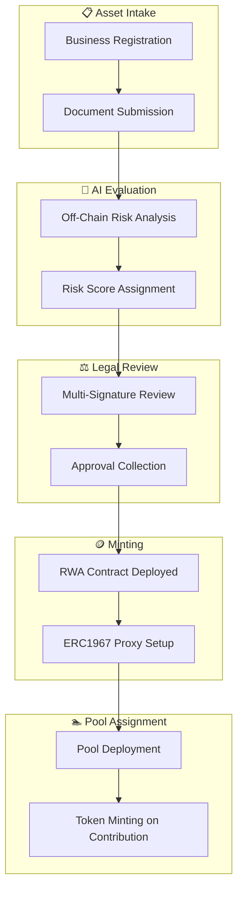

# Tokenization Overview

Tokenization is the process of creating a digital representation of a real-world asset on the blockchain. On Slices, this is done through the **RWA (Real World Asset)** token contract.

## What Can Be Tokenized

The platform supports various business types:

- **Growth** — established businesses seeking expansion capital
- **Startup** — early-stage ventures with growth potential
- **Franchise** — franchise operations looking to fund new locations

Each business undergoes an off-chain AI-based risk evaluation. The evaluation is performed outside the blockchain by the AI Risk Evaluator, and the resulting risk score is passed to the smart contract as part of the deployment parameters.

## Token Standard: ERC1155

RWA tokens use the **ERC1155** multi-token standard. This means a single contract can manage multiple token IDs, each representing a different pool or funding round.

Benefits of ERC1155:

- **Batch operations** — mint, burn, and transfer multiple token types in a single transaction
- **Supply tracking** — each token ID has its own total supply
- **Metadata** — each token ID has a unique metadata URI
- **Efficiency** — lower gas costs compared to deploying separate ERC20 contracts

## Tokenization Flow



1. **Business creation** — the business registers on the platform
2. **Off-chain AI evaluation** — the AI evaluator analyzes the business off-chain and assigns a risk score; the score is submitted to the smart contract
3. **Multi-signature approval** — authorized signers review and approve the deployment
4. **RWA deployment** — `Factory.deployRWA()` creates a new RWA token contract via ERC1967 proxy
5. **Pool deployment** — `Factory.deployPool()` creates a pool linked to the RWA token
6. **Token minting** — when participants contribute HOLD, the pool mints RWA tokens to them

## Fees

The platform charges fees at several stages of the tokenization lifecycle:

- **`createRWAFee`** — a one-time fee in HOLD tokens charged when deploying a new RWA contract via `Factory.deployRWA()`. The caller must pay this fee within the configured range.
- **`createPoolFeeRatio`** — a ratio-based fee applied when deploying a new pool via `Factory.deployPool()`. It is calculated as a percentage of the pool's target raise amount.
- **`entryFee`** — a fee deducted from a participant's contribution when they enter a pool and mint RWA tokens. The fee is taken in HOLD tokens and reduces the amount that goes into the pool.
- **`exitFee`** — a fee deducted when a participant exits a pool and burns their RWA tokens. The fee is taken from the returned HOLD amount.

All fee parameters are bounded by Governance-configured ranges and can be adjusted within those bounds by authorized roles.

### Governance-Controlled Parameters

Beyond fees, several other critical parameters are bounded by Governance through the DAO:

- **Risk Score Limits** — `minBusinessRiskScore`, `maxBusinessRiskScore`, `minPoolRiskScore`, `maxPoolRiskScore` define the acceptable range for AI-assigned risk scores (0–100). Any deployment with a risk score outside these bounds is rejected by the smart contract.

- **Financial Limits** — `expectedHoldAmount`, `expectedRwaAmount`, and `rewardPercent` all have Governance-configured minimum and maximum ranges, ensuring that pool sizes and reward rates remain within protocol-defined bounds.

- **Time Limits** — `entryPeriod` and `completionPeriod` are bounded by Governance, preventing pools from having unrealistically short or excessively long timelines.

- **Tranche Limits** — the number of outgoing and incoming tranches, their percentages, and intervals are all bounded by Governance (see [Tranches](#tranches-outgoing--incoming) below).

- **Multi-Signature Limits** — the number of authorized signers and the minimum required signatures are configurable through Governance (see [Multi-Signature Approval](#multi-signature-approval)).

All these parameters are validated against Governance-configured ranges at deployment time. Any attempt to set a value outside its range is rejected by the smart contract.

## Automated Market Maker (AMM)

Each pool uses a **constant product AMM** formula to determine the exchange rate between HOLD and RWA tokens:

```
k = HOLD_reserve * RWA_supply
```

When a participant contributes HOLD to mint RWA tokens, the pool calculates the amount of RWA to mint using:

```
RWA_minted = RWA_supply - k / (HOLD_reserve + HOLD_contributed)
```

This formula ensures that the price of RWA tokens adjusts dynamically based on supply and demand. Early participants receive a more favorable rate, while later participants pay a higher price as the pool approaches its target.

If `fixedSell` is enabled, the pool sells tokens at a fixed price instead of using the AMM curve.

## Tranches (Outgoing / Incoming)

Pools are structured into **tranches** — time-based segments that govern when participants can enter, receive payouts, and exit.

### Outgoing Tranches

Outgoing tranches define the schedule of **payouts** to token holders. Each outgoing tranche has:

- **`targetTimestamp`** — when the payout is scheduled
- **`amount`** — the total HOLD amount to be distributed in this tranche
- **`distributed`** — how much has already been paid out

When a payout is due, the pool distributes HOLD proportionally to all current RWA token holders based on their share of the total supply.

### Incoming Tranches

Incoming tranches define the schedule of **contributions** from participants. Each incoming tranche has:

- **`targetTimestamp`** — when the contribution window opens
- **`amount`** — the total HOLD amount expected in this tranche
- **`filled`** — how much has been contributed so far

Participants can contribute HOLD and mint RWA tokens during the active incoming tranche windows. Once a tranche is filled, the next tranche becomes available.

### Floating Tranches

In addition to fixed tranches, pools can use **floating tranches** — tranches with flexible timing and amounts. Floating tranches are useful for businesses with variable revenue streams or uncertain payout schedules.

#### Floating Outgoing Tranches

Floating outgoing tranches allow the pool owner to schedule payouts at flexible timestamps rather than fixed ones. Each floating outgoing tranche has:

- **`timestamp`** — the scheduled payout time (can be adjusted within Governance-configured bounds)
- **`amount`** — the HOLD amount to distribute
- **`distributed`** — how much has already been paid out
- **`state`** — the current status of the tranche (pending, claimed, etc.)

The pool can have multiple floating outgoing timestamps, each with configurable intervals and percentages, all bounded by Governance.

#### Floating Incoming Tranches

Floating incoming tranches allow flexible contribution schedules. Each floating incoming tranche has:

- **`timestamp`** — when the contribution is due
- **`amount`** — the expected HOLD amount
- **`filled`** — how much has been contributed
- **`expired`** — the deadline for this tranche
- **`state`** — the current status

All floating tranche parameters (count, intervals, percentages, amounts, timestamps, expiry, states) are bounded by Governance-configured minimum and maximum ranges, ensuring flexibility within safe protocol limits.

### How Participants Receive Payments

1. When an outgoing tranche is due, the pool contract calculates each holder's share based on their RWA token balance
2. The holder claims their payout by calling the pool's claim function
3. The payout is sent in HOLD tokens, and the tranche's `distributed` amount is updated
4. Participants can exit the pool at any time by burning their RWA tokens, subject to the `exitFee`

## Multi-Signature Approval

Every RWA token and pool deployment requires approval from authorized signers. This ensures that only verified businesses can tokenize assets on the platform.

### Signer Roles

- **Authorized Signers** — a set of addresses permissioned to review and approve deployments. The number of signers is configurable through Governance (DAO), with configurable minimum and maximum bounds (e.g., 3–5 signers).
- **`minSignersRequired`** — the minimum number of signatures needed for a deployment to proceed. This value is also configurable through Governance, with its own minimum and maximum bounds (e.g., 2–3 out of the total signers).

### Approval Process

1. **Submission** — the deployment parameters (business data, risk score, fee configuration) are submitted on-chain
2. **Independent review** — each authorized signer independently verifies the parameters off-chain
3. **Signing** — each signer submits their cryptographic signature on-chain, approving the deployment
4. **Execution** — once `minSignersRequired` signatures are collected, the deployment is executed automatically

This multi-signature mechanism reduces the risk of a single compromised key being used to authorize fraudulent deployments.

## Token Lifecycle

- **Creation** — token ID is created when a pool is deployed
- **Minting** — tokens are minted to participants when they contribute HOLD
- **Holding** — participants hold tokens representing their stake
- **Burning** — tokens are burned when participants exit the pool
- **Completion** — when all funds are returned, the pool is fully settled
